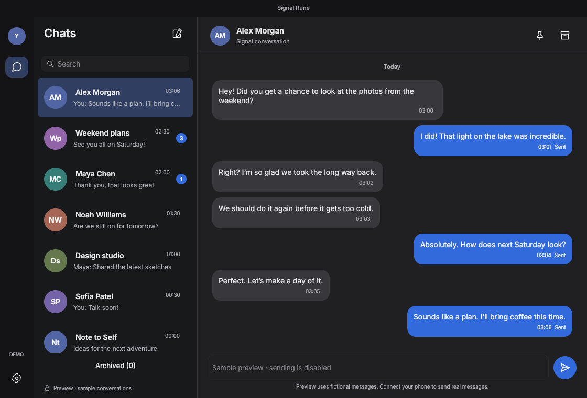

# Signal Rune

An **experimental, independent native desktop client for Signal**, written in Rust with [Anomaly's Rune](https://github.com/anomalyco/rune) and rune-kit (the native OpenCode component library). It follows Signal Desktop's conversation layout, with dark and light appearances.

**This is not yet an exact clone or a production-ready replacement.** See the [versioned parity inventory](docs/PARITY.md) and [validation status](docs/STATUS.md) for implemented features, limitations, and the release gate. It is not affiliated with Signal Messenger LLC.



[Light appearance](docs/design/chat-light.png) · [Linking design fixture](docs/design/linking-fixture.png) · [30-scene layout report](docs/design/report.json)

## Downloads

Open [GitHub Actions → Desktop builds](https://github.com/RyanLatimer/signal-rune/actions/workflows/build.yml), choose a successful run, and download its platform artifact:

- **macOS Apple Silicon**: `.dmg`, contains a native `.app`.
- **Windows x64**: portable `.zip`; extract the entire folder and launch `signal-rune.exe`.
- **Linux x64**: `.tar.gz`; extract the entire folder and run `./signal-rune`. Requires libxkbcommon, Wayland client libraries and a Vulkan-capable driver (Mesa software rendering works).

Archives bundle signal-cli 0.14.10 with the source-available Signal Rune privacy extension and a Java 25 runtime. Keep the extracted bundle intact; macOS stores its runtime inside the `.app`, and Windows/Linux keep it beside the executable. Builds are unsigned (macOS ad-hoc signed), not notarized. Intel macOS and Windows ARM are intentionally excluded. There is no automatic updater yet.

## Link your phone

1. Launch the app and choose **Link a device**.
2. On your phone open Signal → Settings → Linked devices → Link new device.
3. Scan the QR code and approve **Signal Rune**.
4. Wait for contact/group synchronization, then select a conversation or choose **New message**.

The QR is a real short-lived Signal provisioning URI generated by signal-cli. If it expires or is declined, generate a new one. Restarting reuses your linked identity. To revoke it, unlink **Signal Rune** on your phone. This client uses a separate account directory from official Signal Desktop and other signal-cli installations.

Messages, drafts, pins, preferences and read state are stored in authenticated encrypted history and restored on restart. Encryption keys use the OS keychain; on Linux without a secret service, a private key file is used and reported in Settings. New phone-sent messages and read state sync between linked devices. Existing phone message history is not imported yet. The engine persists identity keys and contacts in the OS application-data directory; protect your device and use disk encryption. Disappearing and view-once message contents are deliberately not displayed or retained by the UI. Calls, attachments and safety-number verification are not implemented; this build is for development and testing, not sensitive conversations.

## Build from source

Rust **1.99.1** is pinned in `rust-toolchain.toml`. Rune is pinned to a Git commit and all dependency versions are locked.

Linux build dependencies (Debian/Ubuntu):

```sh
sudo apt-get install libxkbcommon-dev libwayland-dev mesa-vulkan-drivers
cargo build --locked
```

For a development build install [signal-cli 0.14.10](https://github.com/AsamK/signal-cli/releases/tag/v0.14.10) and Java 25. To enable synchronized typing privacy, compile the bundled extension against that distribution using a Java 25 JDK:

```sh
JAVA_HOME=/path/to/jdk25 python3 scripts/extend_engine.py /path/to/signal-cli-0.14.10
```

Then run:

```sh
# If signal-cli is not already on PATH:
export SIGNAL_RUNE_CLI=/absolute/path/to/signal-cli-0.14.10/bin/signal-cli
cargo run --locked
```

An unextended external engine can still link and exchange messages, but typing remains paused because its synchronized privacy setting cannot be verified. Packaged builds already include the extension and need no development tools.

On Windows set `SIGNAL_RUNE_CLI` to its `signal-cli.bat` launcher. Bundled packages locate their engine and Java automatically. `SIGNAL_RUNE_CLI` explicitly overrides the bundled engine.

```sh
cargo fmt --all --check
cargo clippy --locked --all-targets -- -D warnings
cargo test --locked
python3 -m pip install -r requirements-design.txt
python3 scripts/verify_design.py --binary target/debug/signal-rune
```

The design script renders the **actual Rune GPU UI**, including accessibility/element trees, across fourteen scenes and three window sizes. Evidence and its machine-readable report go to `target/design/`. Snapshot runs never start the Signal engine or access a real account. `chat-dark` and `chat-light` scenes contain explicitly labeled fictional conversations; they cannot send messages.

```sh
cargo run -- --scene chat-dark --snap target/design/preview.png
cargo build --release --locked
# With JAVA_HOME pointing to a Java 25 distribution:
python3 scripts/package.py
```

## Architecture

- `src/ui.rs`: native Rune views, rune-kit fields/buttons, themes, vector icons, QR rendering, design scenes.
- `src/main.rs`: asynchronous request state machine, conversation state, delivery status, linking and keyboard shortcuts.
- `src/storage.rs`: encrypted SQLite records, keychain integration, worker commits and restart recovery.
- `src/sync.rs`: typing/receipt handling, phone sync, alias reconciliation, durable outbox and conversation controls.
- `src/model.rs`: documented signal-cli receive-envelope parsing and conversation model.
- `src/transport.rs`: a managed signal-cli subprocess over private stdin/stdout. No open network listener; readers and writers run off the UI thread. The child is terminated when the app exits.
- `scripts/package.py`: checksum-verified engine bundling, per-platform packaging, Java and engine smoke test.
- `.github/workflows/build.yml`: three native build runners, tests, lint, visual evidence and downloadable artifacts.

AGPL-3.0-only. See [LICENSE](LICENSE) and [THIRD_PARTY.md](THIRD_PARTY.md).
